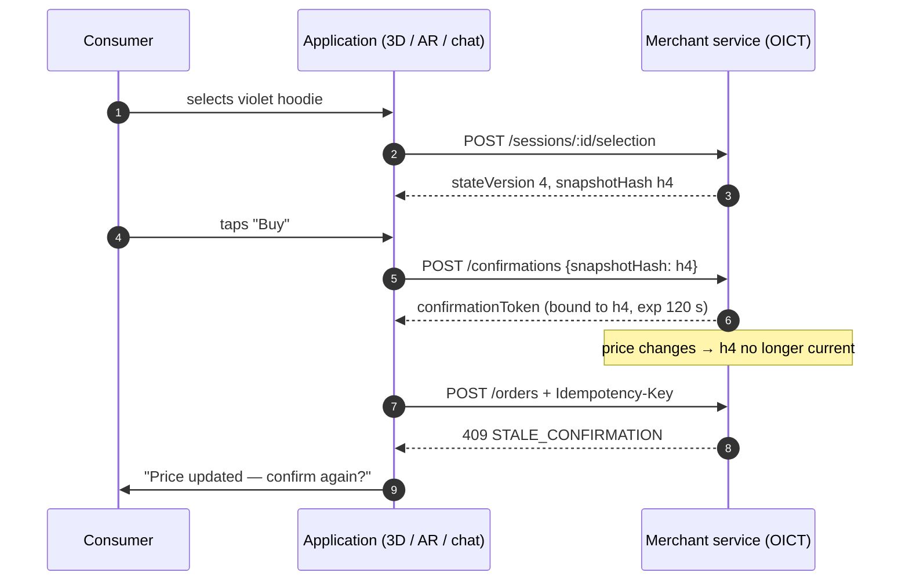

# 02 · State–Order Binding

## 2.1 The problem

In an immersive or conversational interface, *what the consumer is looking at* changes constantly: they rotate a 3D model, switch from violet to teal, pick up a different object, or receive an assistant reply that was generated for the previous selection. Meanwhile the merchant may change a price. A purchase request that does not say *which state it was made against* cannot tell an intended order from a stale one.

## 2.2 Sessions and state versions

A **session** joins one consumer and one application. The service holds the session's current **selection** (`sceneObjectId`, `sku`, `variantId`, `quantity`) and a monotonically increasing **`stateVersion`**.

**STB-1.** Every change to the selection **MUST** increment `stateVersion` and **MUST** produce a new snapshot hash.

## 2.3 Interaction snapshot

The **interaction snapshot** is the server's authoritative description of the current state. See [`schemas/interaction-snapshot.schema.json`](../schemas/interaction-snapshot.schema.json).

```json
{
  "sessionId": "ses_…",
  "stateVersion": 4,
  "sceneObjectId": "obj-hoodie-rack",
  "sku": "SYN-HOODIE-01",
  "variantId": "violet-m",
  "variantVersion": 1,
  "priceVersion": 1,
  "unitPriceMinor": 4200,
  "currency": "USD",
  "quantity": 1
}
```

**STB-2.** The snapshot hash **MUST** be `sha256:` followed by the lowercase hex SHA-256 of the snapshot's canonical JSON (keys sorted recursively, no insignificant whitespace, `undefined` members omitted). Two services that agree on the snapshot therefore agree on its hash.

**STB-4.** Prices, variant attributes and totals in the snapshot **MUST** come from the merchant's catalog, never from the client.

## 2.4 Consumer confirmation

When the consumer presses *buy*, the client sends the snapshot hash it was rendering.

**STB-3.** The service **MUST** compare the submitted hash with the current snapshot hash and **MUST** refuse a mismatch with `STALE_CONFIRMATION`. The client then re-renders and asks again.

On success the service issues a **confirmation token** that binds `sessionId`, `consumerId`, `snapshotHash`, `stateVersion`, `totalMinor`, `currency`, optional `guardianConsentRef`, issue and expiry times and a unique `nonce`. See [`schemas/confirmation-claims.schema.json`](../schemas/confirmation-claims.schema.json).

**STB-5.** Confirmation tokens **MUST** be integrity-protected (the reference server uses HMAC-SHA-256; a deployment **MAY** use JWS). A token that is malformed, altered, or bound to a different session **MUST** fail with `CONFIRMATION_INVALID`.

**STB-6.** Confirmation tokens **MUST** expire. A lifetime of 120 seconds is **RECOMMENDED**; it **MUST NOT** exceed 300 seconds. Expired tokens fail with `CONFIRMATION_EXPIRED`.

## 2.5 Order placement

**STB-7.** At placement the service **MUST** recompute the current snapshot hash and **MUST** refuse the order with `STALE_CONFIRMATION` if it differs from the hash in the confirmation token. This catches price changes, variant switches and scene changes that happened *after* confirmation.

**STB-8.** The created order **MUST** record the snapshot and snapshot hash it was placed against, so any later dispute can be resolved against exactly what the consumer confirmed.

## 2.6 Sequence


