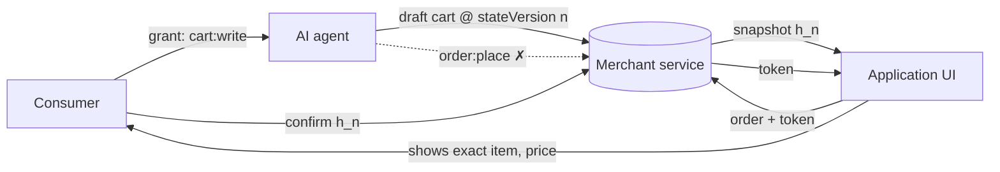

# 03 · AI Agent Controls

An **agent** is software that acts for a consumer: a conversational shopping assistant, an in-world NPC guide, or a general-purpose AI agent connected through an agentic commerce protocol. OICT's principle is simple: **agents prepare, people decide.**

**AGT-1.** An agent **MUST NOT** hold the `order:place` scope, and a service **MUST NOT** create an order on a request authenticated as an agent. Attempting to grant `order:place` to an agent fails with `AGENT_FORBIDDEN`. An agent that submits an order request — even carrying a valid consumer confirmation — fails with `SCOPE_INSUFFICIENT` or `AGENT_FORBIDDEN`.

**AGT-2.** An agent holding `cart:write` **MAY** prepare a **draft cart** for the consumer's session. A draft cart is never an order; it records the `stateVersion` and `snapshotHash` it was built on.

**AGT-3.** A draft-cart request **MUST** name the `stateVersion` the agent reasoned about. If the session has moved on, the service **MUST** refuse with `STALE_STATE`. This stops an agent from acting on information the consumer has already left behind.

**AGT-4 (client rule).** An application that shows agent responses **MUST** bind each response to the `(sceneObjectId, variantId, selectionVersion)` it was requested for, and **MUST NOT** present a response as describing the current selection unless all three match. A late answer about product A arriving after the consumer switched to product B is discarded or clearly labelled. The reference helper is [`src/core/agent-binding.ts`](../src/core/agent-binding.ts); this rule is verified by unit tests rather than the HTTP conformance suite because it lives in the client.

**AGT-5.** A grant whose subject is an agent and whose root consumer is in the `13-17` band **MUST** carry a `guardianConsentRef` (see [04](04-minor-protection.md)); otherwise it fails with `GUARDIAN_CONSENT_REQUIRED`.

## Flow

## Relationship to agentic commerce protocols

Open agentic commerce protocols already require that purchases be backed by verifiable user consent and that delegated payment credentials be scoped and logged. OICT does not replace those mechanisms. It adds the *interaction-state* half: the consent must be about **the specific snapshot the person saw**, and must be fresh.
